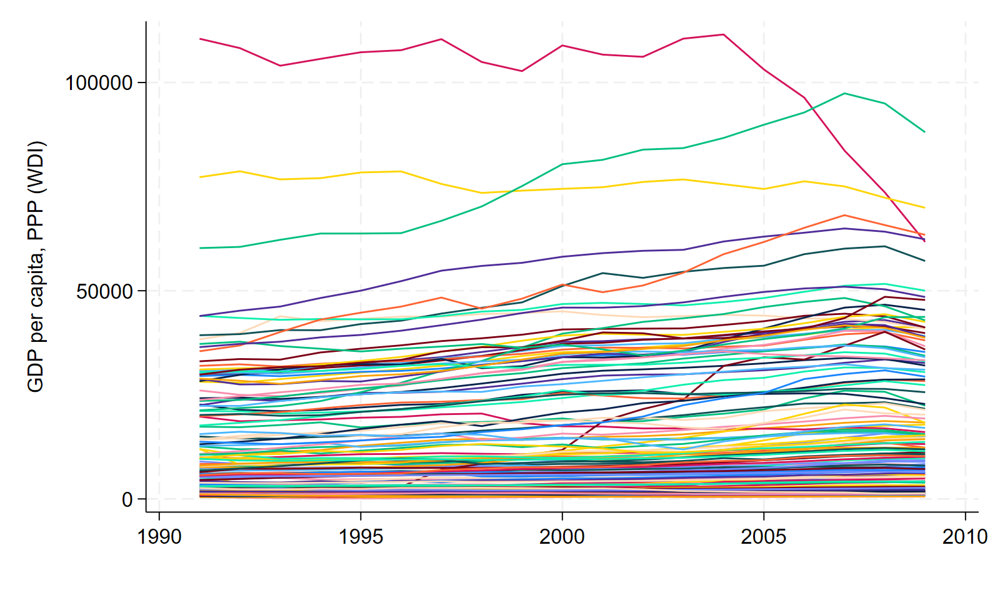
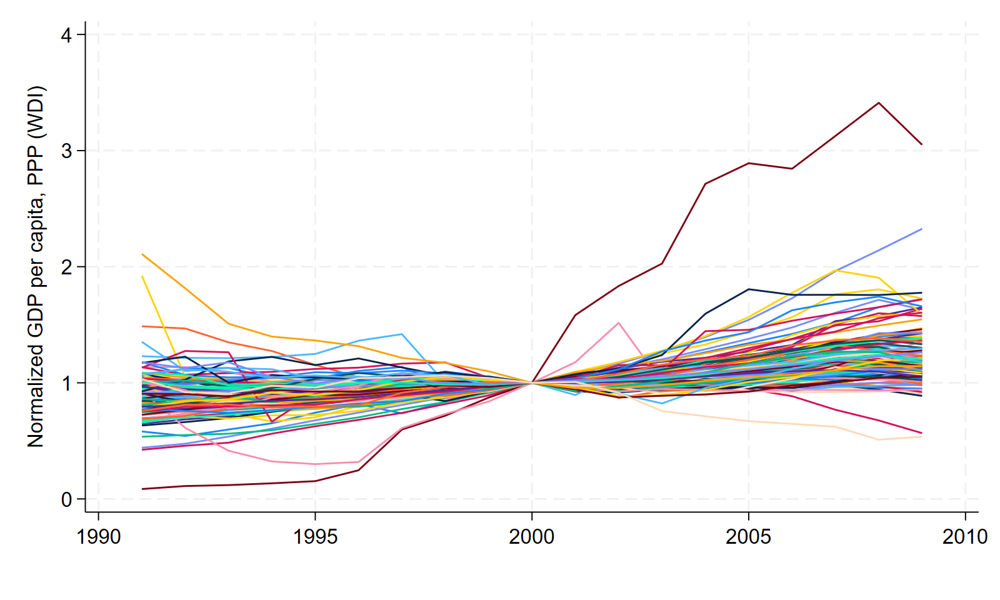

# normbydate


A Stata command for normalizing variables by their value at a baseline date.

## Description

`normbydate` divides a variable by its value on a user-specified baseline date, within each group. The baseline is supplied as a literal string and the time frequency is inferred from the display format of the date variable: `%td` (daily), `%tm` (monthly), or `%ty` (yearly).

## Installation

From Stata (14 or newer), install directly from GitHub:

```stata
net install normbydate, from("https://raw.githubusercontent.com/jgcarrenobustos/normbydate/main/") replace
help normbydate
```

Note: the URL must be the `raw.githubusercontent.com` one; `https://github.com/...` serves an HTML page and `net install` fails.

To get the test script as well: `net get normbydate, from("https://raw.githubusercontent.com/jgcarrenobustos/normbydate/main/")`.

Alternatively, download `normbydate.ado` and `normbydate.sthlp` and put them in your PERSONAL ado folder (type `sysdir` in Stata to see where it is).

## Syntax

```stata
normbydate varname , date("literal") datevar(varname) 
    [by(varlist) generate(newvar) replace scale(#) strictfmt]
```

## Options

- `date("literal")`: Baseline period as a plain string (no `td()/tm()/tw()/…`). Examples: `"19mar2002"`, `"2002-03"`, `"2002"`.
- `datevar(varname)`: Time variable. Must be numeric with display format `%td`, `%tm`, or `%ty`.
- `by(varlist)`: Grouping variable(s). Optional only if there is exactly one observation at the baseline date.
- `generate(newvar)`: Name of the normalized variable to create. Default: `norm_varname`.
- `replace`: Allow replacing an existing `generate()` variable.
- `scale(#)`: Scale factor for the index; default `1`. Use `scale(100)` for base=100.
- `strictfmt`: Kept for backward compatibility; `datevar` must always be formatted `%td`, `%tm`, or `%ty`.

## Examples

```stata
* Daily data normalization
normbydate price, date("01jan2020") datevar(date) by(company)

* Monthly data with base=100
normbydate sales, date("2020-01") datevar(month) by(region) scale(100)

* Yearly data
normbydate gdp, date("2010") datevar(year) by(country)
```

## Example Output

The following figures demonstrate the `normbydate` function using GDP (Gross Domestic Production) per capita data from WDI:

### Before Normalization (Raw Data)

*Figure 1: Raw GPP per capita data showing different levels across countries/regions*

### After Normalization (Base Year 2000)

*Figure 2: Same data normalized to year 2000 (base = 1.0) using `normbydate`, showing relative changes over time*

The normalization makes it easy to compare relative trends across different entities, regardless of their absolute levels in the baseline year.

## Files

- `normbydate.ado`: Main command file
- `normbydate.sthlp`: Help file
- `test.do`: Comprehensive test script

## Testing

Run the test script to verify functionality:

```stata
do test.do
```

## Author

**Gabo**  
📧 jgcarren@gmail.com  
🐙 [GitHub](https://github.com/jgcarrenobustos)

## License

MIT License - see LICENSE file for details